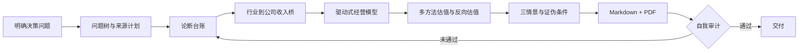

# AI Investment Research Skills

**让AI按投研纪律工作，而不是只生成一份看起来专业的报告。**

[中文](#中文) · [English](#english)

---

## 中文

### 这是什么

一套给AI智能体（Claude Code、Codex等）使用的投资研究技能包。目前包含 **公司深度研究（company-deep-research）** 技能：给定一家公司和一个投资问题，AI按照机构研究的方法完成取证、建模、估值、情景分析和自我审计，输出可编辑的Markdown报告和排版好的PDF研报。

### 为什么做这个

直接让AI"写一份某公司的研报"，通常会得到一份流畅但不可靠的文本：

- 事实、管理层说法和AI自己的推测混在一起，读者分不清
- 数据没有出处，或出处只是二手转载
- 行业空间很大，但没有说明怎么转化成这家公司的收入
- 估值只给一个数字，不说明当前股价隐含了什么预期
- 证据不足时，AI会用"看起来精确"的数字填补空白

这套技能的设计思路来自审计和投研工作：**结论必须能追溯到证据，证据必须分等级，不知道的就写不知道。**

### 核心设计

**1. 四类论断标签**

报告中的每条关键论断都必须标注性质：

| 标签 | 含义 | 要求 |
|---|---|---|
| `[事实]` | 有可验证证据直接支持 | 必须引用来源 |
| `[公司口径]` | 管理层目标、市占率、客户、技术性能等自述 | 注明出处，尽量寻找独立交叉验证 |
| `[计算]` | 基于披露数据的推算 | 列出公式、单位、期间和输入来源 |
| `[判断]` | 解读、预测、情景、投资观点 | 同时列出支持和反对的证据 |

**2. 证据等级与论断台账**

来源按可靠性排序：经审计财报、监管文件、政府统计 > 技术文档、专利、论文 > 公司投资者材料 > 行业数据库 > 媒体报道 > 专家访谈 > 聚合网站和匿名信息。

动笔之前先建立论断台账（Claim Ledger），记录每条关键论断的来源、页码、数据期间、置信度、交叉验证和反证。思路与审计底稿一致：每个结论都能回溯到底层证据。

**3. 行业到公司的收入桥**

不允许直接用"行业空间很大"推出"公司前景很好"，必须建立可见的推导链：

```
行业需求单位 × 单位价值量 × 可触达份额 × 公司获取率 × 价格 = 公司收入
```

并用产能、良率、客户认证、供应约束和竞争反应进行检验。产能公告不等于合格产出，框架协议不等于确定收入。

**4. 硬性门槛**

正式的上市公司报告必须包含：三年以上历史数据、三年以上分部驱动预测、至少两种独立估值方法、反向估值（当前价格隐含了什么预期）、与经营模型勾稽一致的悲观/基准/乐观三情景，以及证伪条件。

数据不足时不得编造，必须说明缺失的证据及其对结论置信度的影响。

**5. 交付前自我审计**

- 30项质量检查表逐项打分（满分60，正式报告需达到52分，关键项不得为0）
- `report_audit.py` 自动检查报告结构、标签数量、引用覆盖、估值方法和未处理的占位符
- 重新验算预测、估值、每股价值和敏感性
- 渲染PDF后逐页检查图表和表格

### 工作流程



### 三种模式

| 模式 | 适用场景 |
|---|---|
| 上市公司正式模式 | 深度研报、投资价值分析、上市公司尽调 |
| 非上市公司正式模式 | VC/PE尽调：以商业化证据、单位经济、融资与稀释、回报情景替代公开市场预测 |
| 研究简报模式 | 用户明确只需要简短回答或更新时使用，并声明不是完整报告 |

### 目录结构

```
skills/company-deep-research/
├── SKILL.md                      # 技能主文件：路由、硬性门槛、工作流、输出规则
├── references/
│   ├── research-method.md        # 证据等级、三角验证、论断分类、论断台账
│   ├── citation-standard.md      # 来源计划与页码级引用规范
│   ├── public-company-model.md   # 上市公司驱动式经营模型
│   ├── valuation-framework.md    # DCF、SOTP、可比公司、反向估值
│   ├── report-template.md        # 16章决策导向报告模板
│   ├── quality-checklist.md      # 30项质量评分表
│   └── pdf-output.md             # 图表与PDF排版规范
├── scripts/
│   ├── dcf_valuation.py          # FCFF DCF与WACC/永续增长率敏感性表
│   ├── valuation_sensitivity.py  # 各情景下当前估值隐含的EV/收入、EV/EBITDA倍数
│   ├── generate_report_charts.py # 从JSON生成统一风格图表
│   ├── render_report_pdf.py      # Markdown渲染为中文PDF研报
│   └── report_audit.py           # 报告结构与证据覆盖自动审计
└── agents/openai.yaml            # Codex 接入配置
```

### 使用方法

**Claude Code**：将 `skills/company-deep-research` 文件夹复制到 `~/.claude/skills/`，然后直接提出研究需求，例如：

> 对英伟达做一份深度研究，判断当前估值隐含了怎样的数据中心收入增长预期。

**其他智能体**：将 `SKILL.md` 和 `references/` 作为系统指令或知识库提供给模型。

**单独使用脚本**：

```bash
pip install -r requirements.txt
cd skills/company-deep-research

# DCF估值与敏感性表
python3 scripts/dcf_valuation.py --fcff 1.2 1.8 2.6 3.4 4.2 \
  --wacc 0.10 --terminal-growth 0.03 --net-debt 5 --shares 100 --unit "RMB mn"

# 审计一份报告
python3 scripts/report_audit.py REPORT.md --mode public-formal

# 渲染PDF
python3 scripts/render_report_pdf.py REPORT.md REPORT.pdf
```

### 后续计划

- [ ] 发布完整样例报告（含论断台账与审计结果）
- [ ] 新增硬科技早期项目筛选技能：从技术成熟度、工程部署、客户验证和商业化进展四个维度评估项目，输出待核查问题清单
- [ ] 验证记录：对比本技能与直接提问AI的输出差异

### 关于作者

尹远，约翰霍普金斯大学金融硕士在读，本科国际会计。曾在普华永道、安永从事审计，在中信证券股权资本市场部和中科创星行业研究部实习，研究方向为AI芯片与AI计算架构。

研究方法论、证据标准与质量门槛由作者基于审计与投研经验设计；文本与脚本的实现借助AI完成。

### 免责声明

本项目用于研究方法学习与交流，生成的内容不构成任何投资建议。AI可能产生错误，所有结论应由使用者独立核实。

---

## English

### What it is

A skill pack that makes AI agents (Claude Code, Codex, etc.) follow institutional investment-research discipline. The current skill, **company-deep-research**, takes a company and a decision question and produces an evidence-traced report in Markdown and PDF: source planning, an industry-to-revenue bridge, a driver-based operating model, multi-method valuation with reverse expectations, bear/base/bull scenarios, falsification conditions, and a self-audit before delivery.

### Why

Asking an AI to "write a research report" usually yields fluent text that mixes facts, management claims, and the model's own guesses, with weak sourcing and falsely precise numbers. This skill applies an auditor's standard: every conclusion traces to evidence, evidence is ranked, and unknowns stay unknown.

### Key design choices

- **Claim labels**: every material claim is tagged `[Fact]`, `[Company claim]`, `[Calculation]`, or `[Judgment]`.
- **Evidence hierarchy and claim ledger**: audited filings and regulator records rank above company materials, which rank above media and aggregators. Each decision-critical claim is logged with source, page, period, confidence, corroboration, and contradictions.
- **Industry-to-company bridge**: industry growth only counts through a visible path to company volume, price, revenue, and margin.
- **Hard gates**: 3+ historical years, 3+ driver-based forecast years, 2+ independent valuation methods, reverse valuation, and reconciled scenarios. Missing evidence is disclosed, never invented.
- **Self-audit**: a 30-item scored checklist, an automated report audit script, recalculation of outputs, and page-by-page PDF review.

### Usage

Copy `skills/company-deep-research` into `~/.claude/skills/` for Claude Code, or supply `SKILL.md` and `references/` to another agent as instructions. Scripts require Python 3 and `pip install -r requirements.txt`.

### Author

Yuan Yin — MS in Finance candidate at Johns Hopkins University; background in audit (PwC, EY), equity capital markets (CITIC Securities), and hard-tech industry research on AI chips and AI computing architecture. The research methodology and quality standards were designed by the author; implementation was built with AI assistance.

### Disclaimer

For research-method learning only. Not investment advice. AI output may contain errors; verify all conclusions independently.
